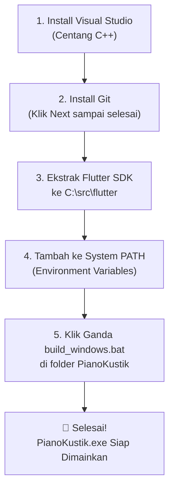

# 📖 Panduan Lengkap: Cara Menghasilkan & Menjalankan PianoKustik (.exe) di Windows
### (Panduan Ramah Pemula & Non-IT)

Panduan ini dibuat khusus langkah-demi-langkah dengan bahasa yang mudah dipahami, tanpa istilah teknis yang rumit. Ikuti langkah di bawah ini secara berurutan.

---

## 📥 1. Bahan-Bahan yang Perlu Di-Download (Semua Gratis & Resmi)

Siapkan 3 bahan utama berikut sebelum memulai:

| No | Software | Fungsi | Link Download Resmi |
|---|---|---|---|
| 1 | **Visual Studio 2022 Community** | Alat pembuat program C++ untuk Windows | [Download Visual Studio Community](https://visualstudio.microsoft.com/vs/community/) |
| 2 | **Git for Windows** | Alat pembantu download & compile Flutter | [Download Git 64-bit](https://git-scm.com/download/win) |
| 3 | **Flutter SDK (Windows)** | Mesin pembuat aplikasi PianoKustik | [Download Flutter Windows (ZIP)](https://docs.flutter.dev/get-started/install/windows/desktop?tab=download) |

---

## 🛠️ 2. Langkah-Langkah Pemasangan (Step-by-Step)



---

### 🔹 LANGKAH 1: Install Visual Studio 2022 (Paling Penting!)
Flutter membutuhkan compiler C++ bawaan Windows agar bisa membuat file `.exe`.

1. Buka file installer yang baru di-download: `VisualStudioSetup.exe`.
2. Klik **Continue** dan tunggu installer menyiapkan data.
3. Anda akan melihat layar bertuliskan **Workloads** (banyak kotak pilihan):
   - Gulir ke bagian **Desktop & Mobile**.
   - Cari kotak bernama:
     👉 **Desktop development with C++** *(atau dalam bahasa Indonesia: Pengembangan desktop dengan C++)*.
   - **CENTANG KOTAK TERSEBUT** (Wajib!).
   ```
   [✔] Desktop development with C++
       ├── MSVC v143 - VS 2022 C++ x64/x86 build tools (tercentang otomatis)
       └── Windows 10/11 SDK (tercentang otomatis)
   ```
4. Di pojok kanan bawah, klik tombol **Install**.
5. Tunggu sampai proses download dan instalasi selesai (bisa memakan waktu 10–20 menit tergantung kecepatan internet).

---

### 🔹 LANGKAH 2: Install Git for Windows
1. Buka file installer Git yang sudah di-download (misal: `Git-2.xx.x-64-bit.exe`).
2. Klik tombol **Next** terus menerus (biarkan semua pengaturan dalam kondisi default).
3. Terakhir klik **Install** dan tunggu sampai selesai, lalu klik **Finish**.

---

### 🔹 LANGKAH 3: Pasang Flutter SDK
1. Cari file ZIP Flutter yang sudah Anda download (misal: `flutter_windows_xxx-stable.zip`).
2. Buka folder `C:\` di laptop/komputer Anda (Local Disk C:).
3. Buat folder baru bernama `src` sehingga lokasinya menjadi `C:\src`.
4. Ekstrak isi ZIP Flutter ke dalam folder tersebut, sehingga foldernya menjadi:
   ```
   C:\src\flutter
   ```
   > ⚠️ **Catatan Penting**: JANGAN letakkan folder flutter di dalam `C:\Program Files` karena Windows akan membatasi izin aksesnya.

---

### 🔹 LANGKAH 4: Mendaftarkan Flutter ke Sistem Windows (Environment Variables)
Agar komputer Anda mengenali perintah `flutter`, kita perlu memberi tahu Windows lokasi folder `bin` dari Flutter:

1. Di keyboard Anda, tekan tombol **Windows**, lalu langsung ketik: **`env`**.
2. Akan muncul menu: **Edit the system environment variables** (atau *Edit variabel lingkungan sistem*). Klik menu tersebut.
3. Sebuah jendela kecil bernama *System Properties* akan muncul. Klik tombol **Environment Variables...** di pojok kanan bawah.
4. Di bagian atas (*User variables for ...*):
   - Cari baris bernama **Path**, lalu klik baris tersebut sampai berwarna biru.
   - Klik tombol **Edit...**.
5. Di jendela baru yang muncul:
   - Klik tombol **New** di sebelah kanan atas.
   - Ketik atau tempel (paste) alamat ini:
     ```
     C:\src\flutter\bin
     ```
6. Klik **OK** di semua jendela yang tadi dibuka untuk menyimpan perubahan.

---

### 🔹 LANGKAH 5: Memeriksa Kesiapan Komputer
Mari pastikan semua bahan sudah terpasang dengan benar:

1. Tekan tombol **Windows + R** di keyboard, ketik `cmd`, lalu tekan **Enter**.
2. Di layar hitam Command Prompt, ketik:
   ```cmd
   flutter doctor
   ```
   lalu tekan **Enter**.
3. Komputer akan memeriksa otomatis. Pastikan muncul tanda centang hijau `[✓]`:
   - `[✓] Flutter`
   - `[✓] Windows Version`
   - `[✓] Visual Studio - develop Windows apps`

*(Jika ada tanda silang pada Android toolchain atau Chrome, itu bisa diabaikan karena kita hanya membuat aplikasi untuk Windows desktop).*

---

## 🚀 3. Waktunya Menghasilkan File PianoKustik.exe!

Sekarang komputer Anda sudah 100% siap. Langkah terakhir sangat mudah:

1. Buka folder proyek **PianoKustik** Anda di Windows Explorer.
2. Cari file bernama:
   👉 **`build_windows.bat`**
3. **Klik ganda (double-click)** pada file `build_windows.bat` tersebut.
4. Sebuah jendela terminal akan otomatis berjalan:
   - Mengunduh library yang dibutuhkan.
   - Meng-compile aplikasi ke format `.exe`.
5. Setelah selesai (sekitar 1–3 menit), terminal akan menampilkan:
   ```
   ========================================================
   [3/3] BUILD SUKSES!
   File EXE: build\windows\x64\runner\Release\PianoKustik.exe
   ========================================================
   ```
   dan **folder hasil build akan langsung terbuka otomatis di layar Anda!**

---

## 🎮 Cara Menjalankan & Membagikan Aplikasi

Di dalam folder yang terbuka (`build\windows\x64\runner\Release`):
- Anda akan menemukan file **`PianoKustik.exe`**.
- Tinggal klik ganda **`PianoKustik.exe`** untuk langsung memainkan piano!

> 💡 **TIPS PENTING JIKA INGIN DIBAWA KE LAPTOP LAIN:**
> Jangan hanya meng-copy file `PianoKustik.exe` sendirian. Salin **seluruh isi folder `Release`** (termasuk file `.dll` dan folder `data`) ke dalam flashdisk atau jadikan file ZIP, agar aplikasi bisa berjalan normal di komputer Windows mana pun tanpa perlu install Flutter lagi!
